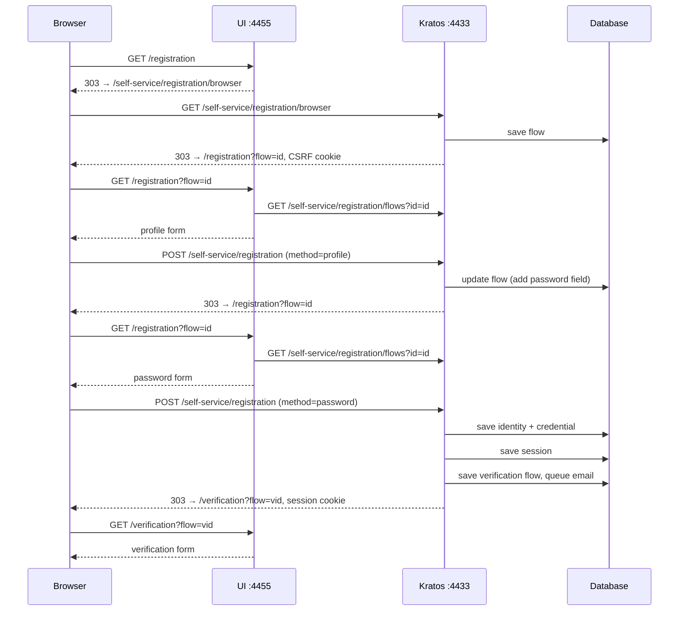

# Registration

## Reference implementation

[Ory Kratos](https://github.com/ory/kratos) (commit [`b86338d`](https://github.com/ory/kratos/tree/b86338da04a040247a07f46100a86dcfb3875909)) is the identity server. It runs the registration flow, checks the input, and stores identities and sessions. The UI is a separate web app that only renders the forms Kratos describes.

- Kratos (public API): `http://127.0.0.1:4433`
- UI: `http://127.0.0.1:4455`

### Steps

1. **Browser** opens the sign-up page: `GET :4455/registration`.
2. **UI** has no flow yet, so it redirects the browser to Kratos to start one: `GET :4433/self-service/registration/browser`.
3. **Kratos** creates a registration flow, sets a [CSRF](#csrf) cookie, and redirects back to the UI with the flow ID: `/registration?flow=<id>`.
4. **UI** fetches the flow from Kratos (`GET /self-service/registration/flows?id=<id>`) and shows the profile form. The flow describes the form ([server-driven UI](#server-driven-ui), trimmed):

    ```json
    {
      "id": "faaa3fc0-0203-4085-ac76-3b6ca668908a",
      "type": "browser",
      "state": "choose_method",
      "expires_at": "2026-10-12T01:10:49Z",
      "ui": {
        "action": "http://127.0.0.1:4433/self-service/registration?flow=faaa3fc0-…",
        "method": "POST",
        "nodes": [
          { "attributes": { "name": "csrf_token", "type": "hidden", "value": "<token>" } },
          { "attributes": { "name": "traits.email", "type": "email", "required": true } },
          { "attributes": { "name": "traits.name.first", "type": "text" } },
          { "attributes": { "name": "traits.name.last", "type": "text" } },
          { "attributes": { "name": "method", "type": "submit", "value": "profile" } }
        ]
      }
    }
    ```

5. **Browser** submits the profile to Kratos: `POST /self-service/registration?flow=<id>`.

    ```
    Content-Type: application/x-www-form-urlencoded

    csrf_token=<token>
    &traits.email=test@test.com
    &traits.name.first=Test1
    &traits.name.last=Test
    &method=profile
    ```

6. **Kratos** checks the profile, then changes the form stored in the flow for the next screen: the profile fields become hidden and a password field is added. It redirects back to the UI: `/registration?flow=<id>`. No account is created yet. Answering a form post with a redirect is the [Post/Redirect/Get](https://en.wikipedia.org/wiki/Post/Redirect/Get) pattern, so a page refresh does not resubmit the form.
7. **UI** fetches the flow again and shows the password form. The profile values are now hidden fields:

    ```json
    "nodes": [
      { "attributes": { "name": "csrf_token", "type": "hidden", "value": "<token>" } },
      { "attributes": { "name": "traits.email", "type": "hidden", "value": "test@test.com" } },
      { "attributes": { "name": "traits.name.first", "type": "hidden", "value": "Test1" } },
      { "attributes": { "name": "traits.name.last", "type": "hidden", "value": "Test" } },
      { "attributes": { "name": "password", "type": "password", "required": true } },
      { "attributes": { "name": "method", "type": "submit", "value": "password" } },
      { "attributes": { "name": "screen", "type": "submit", "value": "previous" } }
    ]
    ```

8. **Browser** submits the password to Kratos, with the profile again: `POST /self-service/registration?flow=<id>`.

    ```
    csrf_token=<token>
    &traits.email=test@test.com
    &traits.name.first=Test1
    &traits.name.last=Test
    &password=<password>
    &method=password
    ```

9. **Kratos** checks the input, creates the identity and a session, starts email verification, and redirects ([303 See Other](https://developer.mozilla.org/en-US/docs/Web/HTTP/Reference/Status/303)) to the UI's verification page with the [session cookie](https://developer.mozilla.org/en-US/docs/Web/HTTP/Guides/Cookies):

    ```
    HTTP/1.1 303 See Other
    Location: http://127.0.0.1:4455/verification?flow=2f6c3de3-1d88-4dfd-916b-fedc463f39f7
    Set-Cookie: ory_kratos_session=<session>; …
    ```

10. **UI** shows the verification form. The user is now logged in.

### Graph



### Notes

#### Server-driven UI

Kratos decides what the form contains, and the UI only draws it. Each flow carries `ui.nodes` ([UI nodes](https://www.ory.sh/docs/kratos/concepts/ui-user-interface)), a list of fields with name, type, required flag, value and error messages, plus `ui.action` and `ui.method` for where to post. The UI loops over the nodes and renders them. It controls only layout and styling.

This keeps the rules in one place. A new trait in the [identity schema](https://www.ory.sh/docs/kratos/manage-identities/identity-schema) (a [JSON Schema](https://json-schema.org/)), or a new method such as passkeys, shows up in every UI without UI changes. Web, mobile and single-page apps render the same nodes. Kratos checks every submit against the flow it stored, so a client cannot skip a step. Errors come back as the same flow with messages on the fields. The cost is flexibility: a fully custom sign-up sequence is harder, because Kratos decides the steps.

#### CSRF

[Cross-site request forgery](https://owasp.org/www-community/attacks/csrf) (CSRF) is when another site makes the user's browser send a request the user did not intend. Without protection, another site could post a sign-up form to Kratos from the user's browser. The browser would follow the redirect and store the session cookie, so the user would be logged in to an account the attacker created and controls. Anything the user then enters goes into the attacker's account. This is called [login CSRF](https://cheatsheetseries.owasp.org/cheatsheets/Cross-Site_Request_Forgery_Prevention_Cheat_Sheet.html#possible-csrf-vulnerabilities-in-login-forms).

To block this, Kratos requires a secret that only the user's browser holds, and checks that every form post carries it. This is the [double-submit cookie pattern](https://cheatsheetseries.owasp.org/cheatsheets/Cross-Site_Request_Forgery_Prevention_Cheat_Sheet.html#alternative-using-a-double-submit-cookie-pattern):

- **Secret.** On the first request from a browser with no CSRF cookie (step 3, `GET /self-service/registration/browser`), Kratos generates a random secret and stores it in an [`HttpOnly`](https://developer.mozilla.org/en-US/docs/Web/HTTP/Guides/Cookies#block_access_to_your_cookies) cookie named `csrf_token_<hash>`. It is one secret per browser, kept across flows.
- **Form field.** Whenever Kratos builds a form (step 3, and again in step 6), it puts a copy of the secret in the hidden `csrf_token` field. The copy is masked with fresh random bytes each time, which is why the field value differs between steps 5 and 8. Masking protects against [BREACH](https://en.wikipedia.org/wiki/BREACH), an attack that recovers a secret repeated unchanged in compressed HTTPS responses.
- **Check.** On each submit (steps 5 and 8), Kratos unmasks the field and compares it with the cookie. If they don't match, the post is rejected.

Another site can make the browser send the cookie, but the [same-origin policy](https://developer.mozilla.org/en-US/docs/Web/Security/Same-origin_policy) stops it from reading the cookie or the form, so it cannot fill in the field.

API flows for native apps use no cookies, so they skip this check. Instead, Kratos rejects an API flow request that carries cookies or an `Origin` header, since that means it came from a browser.

#### Have I Been Pwned

Kratos rejects passwords that have already leaked in a data breach, because attackers try those first, for example in [credential stuffing](https://owasp.org/www-community/attacks/Credential_stuffing). [NIST SP 800-63B-4 §3.1.1.2](https://pages.nist.gov/800-63-4/sp800-63b.html#passwordver) requires this: a new password SHALL be compared against a blocklist that includes passwords from previous breaches. Kratos asks [Have I Been Pwned](https://haveibeenpwned.com/Passwords) (HIBP), using its [Pwned Passwords API](https://haveibeenpwned.com/API/v3#PwnedPasswords), without ever sending the password: it asks for a bucket of leaked passwords that look alike, then searches the bucket itself.

This runs on the password submit (step 8), after the length check (at least 8 characters) and a check that the password is not too similar to the email (by [Levenshtein distance](https://en.wikipedia.org/wiki/Levenshtein_distance) and longest common substring):

1. Kratos hashes the password with [SHA-1](https://en.wikipedia.org/wiki/SHA-1). `password` becomes `5BAA61E4C9B93F3F0682250B6CF8331B7EE68FD8`.
2. It sends only the first 5 characters: `GET https://api.pwnedpasswords.com/range/5BAA6`.
3. HIBP returns every leaked hash starting with that prefix, as suffix and count. For `5BAA6`, that was 1,977 lines on 2026-10-11, including `1E4C9B93F3F0682250B6CF8331B7EE68FD8:52372427`.
4. Kratos looks for its own suffix in the list. If the count is above `max_breaches` (default `0`), the password is rejected with an error on the `password` field.

Hundreds of passwords share each prefix, so HIBP cannot tell which one was checked. This technique is called [k-anonymity](https://en.wikipedia.org/wiki/K-anonymity); Cloudflare [describes its design for HIBP](https://blog.cloudflare.com/validating-leaked-passwords-with-k-anonymity/). SHA-1 is used only because the HIBP dataset is indexed by it; the stored password is hashed separately with [bcrypt](https://en.wikipedia.org/wiki/Bcrypt). If HIBP is unreachable, Kratos accepts the password (`ignore_network_errors` defaults to `true`). This is a fail-open choice: an outage does not block sign-ups, but the leak check is skipped.
