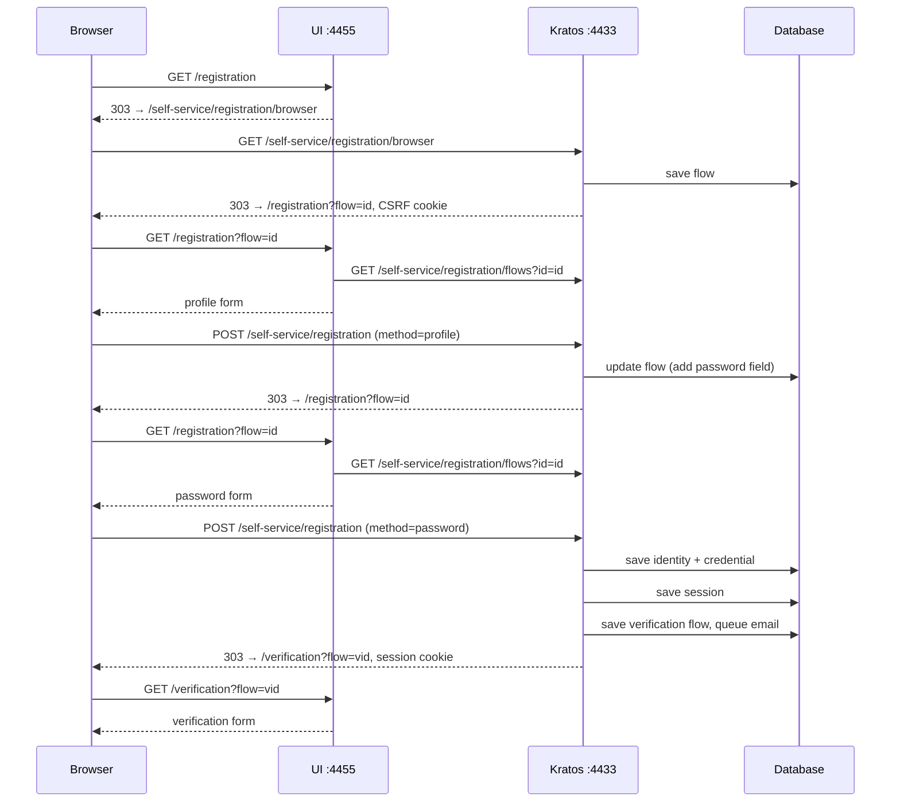
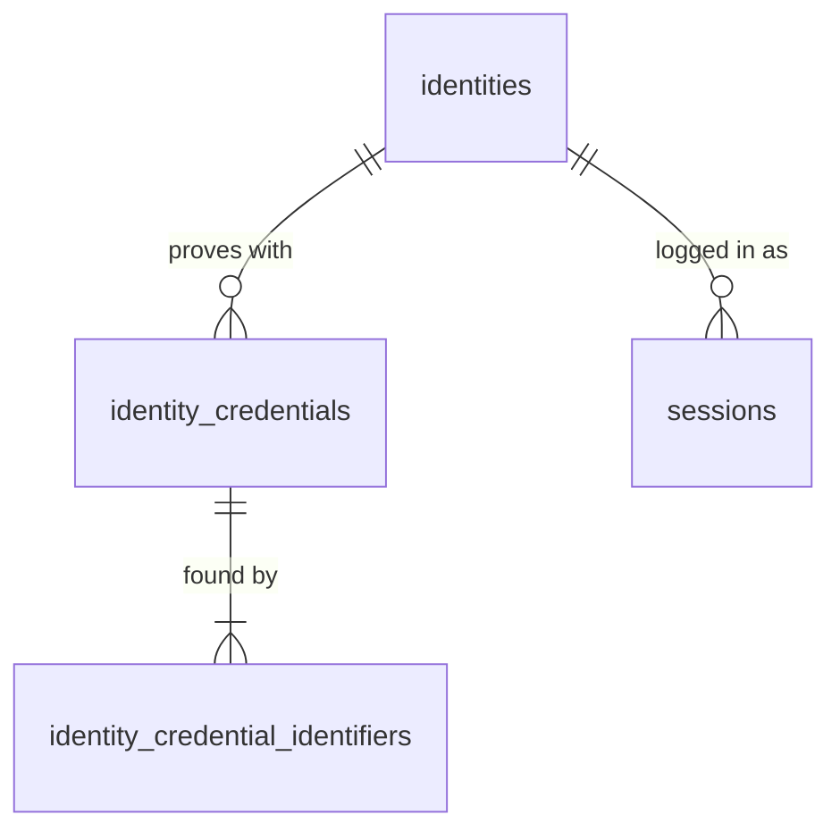

# Registration

## Reference implementation

[Ory Kratos](https://github.com/ory/kratos) (commit [`b86338d`](https://github.com/ory/kratos/tree/b86338da04a040247a07f46100a86dcfb3875909)) is the identity server. It runs the registration flow, checks the input, and stores identities and sessions. The UI is a separate web app that only renders the forms Kratos describes.

- Kratos (public API): `http://127.0.0.1:4433`
- UI: `http://127.0.0.1:4455`

### Steps

1. **Browser** opens the sign-up page: `GET :4455/registration`.
2. **UI** has no flow yet, so it redirects the browser to Kratos to start one: `GET :4433/self-service/registration/browser`.
3. **Kratos** creates a registration flow, sets a [CSRF](#csrf) cookie, and redirects back to the UI with the flow ID: `/registration?flow=<id>`.
4. **UI** fetches the flow from Kratos (`GET /self-service/registration/flows?id=<id>`) and shows the profile form. The flow describes the form ([server-driven UI](#server-driven-ui), trimmed):

    ```json
    {
      "id": "faaa3fc0-0203-4085-ac76-3b6ca668908a",
      "type": "browser",
      "state": "choose_method",
      "expires_at": "2026-10-12T01:10:49Z",
      "ui": {
        "action": "http://127.0.0.1:4433/self-service/registration?flow=faaa3fc0-0203-4085-ac76-3b6ca668908a",
        "method": "POST",
        "nodes": [
          { "attributes": { "name": "csrf_token", "type": "hidden", "value": "<token>" } },
          { "attributes": { "name": "traits.email", "type": "email", "required": true } },
          { "attributes": { "name": "traits.name.first", "type": "text" } },
          { "attributes": { "name": "traits.name.last", "type": "text" } },
          { "attributes": { "name": "method", "type": "submit", "value": "profile" } }
        ]
      }
    }
    ```

5. **Browser** submits the profile to Kratos: `POST /self-service/registration?flow=<id>`.

    ```
    Content-Type: application/x-www-form-urlencoded

    csrf_token=<token>
    &traits.email=test@test.com
    &traits.name.first=Test1
    &traits.name.last=Test
    &method=profile
    ```

6. **Kratos** checks the profile, then changes the form stored in the flow for the next screen: the profile fields become hidden and a password field is added. It redirects back to the UI: `/registration?flow=<id>`. No account is created yet. Answering a form post with a redirect is the [Post/Redirect/Get](https://en.wikipedia.org/wiki/Post/Redirect/Get) pattern, so a page refresh does not resubmit the form.
7. **UI** fetches the flow again and shows the password form. The profile values are now hidden fields:

    ```json
    "nodes": [
      { "attributes": { "name": "csrf_token", "type": "hidden", "value": "<token>" } },
      { "attributes": { "name": "traits.email", "type": "hidden", "value": "test@test.com" } },
      { "attributes": { "name": "traits.name.first", "type": "hidden", "value": "Test1" } },
      { "attributes": { "name": "traits.name.last", "type": "hidden", "value": "Test" } },
      { "attributes": { "name": "password", "type": "password", "required": true } },
      { "attributes": { "name": "method", "type": "submit", "value": "password" } },
      { "attributes": { "name": "screen", "type": "submit", "value": "previous" } }
    ]
    ```

8. **Browser** submits the password to Kratos, with the profile again: `POST /self-service/registration?flow=<id>`.

    ```
    csrf_token=<token>
    &traits.email=test@test.com
    &traits.name.first=Test1
    &traits.name.last=Test
    &password=<password>
    &method=password
    ```

9. **Kratos** checks the input, creates the identity and a session, starts email verification, and redirects ([303 See Other](https://developer.mozilla.org/en-US/docs/Web/HTTP/Reference/Status/303)) to the UI's verification page with the [session cookie](https://developer.mozilla.org/en-US/docs/Web/HTTP/Guides/Cookies):

    ```
    HTTP/1.1 303 See Other
    Location: http://127.0.0.1:4455/verification?flow=2f6c3de3-1d88-4dfd-916b-fedc463f39f7
    Set-Cookie: ory_kratos_session=<session>; …
    ```

10. **UI** shows the verification form. The user is now logged in.

### Graph



### Notes

#### Server-driven UI

Kratos decides what the form contains, and the UI only draws it. Each flow carries `ui.nodes` ([UI nodes](https://www.ory.sh/docs/kratos/concepts/ui-user-interface)), a list of fields with name, type, required flag, value and error messages, plus `ui.action` and `ui.method` for where to post. The UI loops over the nodes and renders them. It controls only layout and styling.

This keeps the rules in one place. A new trait in the [identity schema](https://www.ory.sh/docs/kratos/manage-identities/identity-schema) (a [JSON Schema](https://json-schema.org/)), or a new method such as passkeys, shows up in every UI without UI changes. Web, mobile and single-page apps render the same nodes. Kratos checks every submit against the flow it stored, so a client cannot skip a step. Errors come back as the same flow with messages on the fields. The cost is flexibility: a fully custom sign-up sequence is harder, because Kratos decides the steps.

#### CSRF

[Cross-site request forgery](https://owasp.org/www-community/attacks/csrf) (CSRF) is when another site makes the user's browser send a request the user did not intend. Without protection, another site could post a sign-up form to Kratos from the user's browser. The browser would follow the redirect and store the session cookie, so the user would be logged in to an account the attacker created and controls. Anything the user then enters goes into the attacker's account. This is called [login CSRF](https://cheatsheetseries.owasp.org/cheatsheets/Cross-Site_Request_Forgery_Prevention_Cheat_Sheet.html#possible-csrf-vulnerabilities-in-login-forms).

To block this, Kratos requires a secret that only the user's browser holds, and checks that every form post carries it. This is the [double-submit cookie pattern](https://cheatsheetseries.owasp.org/cheatsheets/Cross-Site_Request_Forgery_Prevention_Cheat_Sheet.html#alternative-using-a-double-submit-cookie-pattern):

- **Secret.** On the first request from a browser with no CSRF cookie (step 3, `GET /self-service/registration/browser`), Kratos generates a random secret and stores it in an [`HttpOnly`](https://developer.mozilla.org/en-US/docs/Web/HTTP/Guides/Cookies#block_access_to_your_cookies) cookie named `csrf_token_<hash>`. It is one secret per browser, kept across flows.
- **Form field.** Whenever Kratos builds a form (step 3, and again in step 6), it puts a copy of the secret in the hidden `csrf_token` field. The copy is masked with fresh random bytes each time, which is why the field value differs between steps 5 and 8. Masking protects against [BREACH](https://en.wikipedia.org/wiki/BREACH), an attack that recovers a secret repeated unchanged in compressed HTTPS responses.
- **Check.** On each submit (steps 5 and 8), Kratos unmasks the field and compares it with the cookie. If they don't match, the post is rejected.

Another site can make the browser send the cookie, but the [same-origin policy](https://developer.mozilla.org/en-US/docs/Web/Security/Same-origin_policy) stops it from reading the cookie or the form, so it cannot fill in the field.

API flows for native apps use no cookies, so they skip this check. Instead, Kratos rejects an API flow request that carries cookies or an `Origin` header, since that means it came from a browser.

#### Have I Been Pwned

Kratos rejects passwords that have already leaked in a data breach, because attackers try those first, for example in [credential stuffing](https://owasp.org/www-community/attacks/Credential_stuffing). [NIST SP 800-63B-4 §3.1.1.2](https://pages.nist.gov/800-63-4/sp800-63b.html#passwordver) requires this: a new password SHALL be compared against a blocklist that includes passwords from previous breaches. Kratos asks [Have I Been Pwned](https://haveibeenpwned.com/Passwords) (HIBP), using its [Pwned Passwords API](https://haveibeenpwned.com/API/v3#PwnedPasswords), without ever sending the password: it asks for a bucket of leaked passwords that look alike, then searches the bucket itself.

This runs on the password submit (step 8), after the length check (at least 8 characters) and a check that the password is not too similar to the email (by [Levenshtein distance](https://en.wikipedia.org/wiki/Levenshtein_distance) and longest common substring):

1. Kratos hashes the password with [SHA-1](https://en.wikipedia.org/wiki/SHA-1). `password` becomes `5BAA61E4C9B93F3F0682250B6CF8331B7EE68FD8`.
2. It sends only the first 5 characters: `GET https://api.pwnedpasswords.com/range/5BAA6`.
3. HIBP returns every leaked hash starting with that prefix, as suffix and count. For `5BAA6`, that was 1,977 lines on 2026-10-11, including `1E4C9B93F3F0682250B6CF8331B7EE68FD8:52372427`.
4. Kratos looks for its own suffix in the list. If the count is above `max_breaches` (default `0`), the password is rejected with an error on the `password` field.

Hundreds of passwords share each prefix, so HIBP cannot tell which one was checked. This technique is called [k-anonymity](https://en.wikipedia.org/wiki/K-anonymity); Cloudflare [describes its design for HIBP](https://blog.cloudflare.com/validating-leaked-passwords-with-k-anonymity/). SHA-1 is used only because the HIBP dataset is indexed by it; the stored password is hashed separately with [bcrypt](https://en.wikipedia.org/wiki/Bcrypt). If HIBP is unreachable, Kratos accepts the password (`ignore_network_errors` defaults to `true`). This is a fail-open choice: an outage does not block sign-ups, but the leak check is skipped.

## Flow

A **registration flow** is one sign-up attempt, stored on the server until it succeeds or expires. It lets the server check that a form post belongs to an attempt it started, that the attempt is still fresh, and what to show next, such as the email typed so far and the errors to fix. A flow holds:

- an **ID**, which appears in the URL and names the attempt;
- a **CSRF token**, which the form must send back;
- its **state**: submitted values (never the password) and errors per field;
- an **expiry time**, after which the flow is rejected and the user starts a new one. The first value is 1 hour.

Noosphere renders the form itself, so the whole flow takes three requests to one server:

| Request | Does |
|---|---|
| `GET /registration` | Creates a flow and redirects to `/registration?flow=<id>` |
| `GET /registration?flow=<id>` | Loads the flow and renders the form from it |
| `POST /registration?flow=<id>` | Checks the flow and CSRF token, then creates the account, signs it in with a session cookie and redirects to `/registration/complete`, or saves the errors into the flow and redirects back to the form |

The redirect after creating a flow puts the flow ID in the URL, so a refresh or the back button shows the same attempt instead of starting a new one. Every form post is also answered with a redirect ([Post/Redirect/Get](https://en.wikipedia.org/wiki/Post/Redirect/Get)), so a refresh never submits the form twice. Once the account is created, the flow is deleted, so its URL starts a new sign-up instead of showing a form that can only fail.

The CSRF token alone is not enough, because an attacker can start a flow of their own and copy its token into a forged form. The token must also be tied to the browser with a cookie, as in the [CSRF](#csrf) note above. A flow is shown only to the browser whose cookie matches it; another browser is given a flow of its own. A browser that does not send the cookie back at all gets a `403` page asking it to allow cookies, instead of a new flow on every request.

## Data model

### Overview

Five tables in three groups:

- **The person:** `identities`.
- **How they prove it:** `identity_credentials` holds the secret, and `identity_credential_identifiers` holds what the user types to find it.
- **Short-lived state:** `registration_flows` for a sign-up in progress, and `sessions` for a logged-in device.



- `identities` 1:M `identity_credentials`: an identity has zero or more credentials, at most one per type.
- `identity_credentials` 1:M `identity_credential_identifiers`: a credential has one or more identifiers.
- `identities` 1:M `sessions`: an identity has zero or more sessions, one per logged-in device.
- `registration_flows` stands alone: a flow exists before any identity does.

Every table uses a [UUIDv7](https://www.rfc-editor.org/rfc/rfc9562#name-uuid-version-7) primary key, generated by PostgreSQL 18 with [`uuidv7()`](https://www.postgresql.org/docs/18/functions-uuid.html). The IDs are unguessable but time-ordered, so new rows append to the index like a sequence. IDs are never used as secrets.

All times are [`timestamptz`](https://www.postgresql.org/docs/18/datatype-datetime.html), so the server's time zone cannot change what is stored.

### Tables

The examples follow Ada, who signs up with `Ada@Example.com`.

#### identities

One row per person. Everything else points to it.

| Column | Type | Notes |
|---|---|---|
| `id` | `uuid` PK | |
| `traits` | [`jsonb`](https://www.postgresql.org/docs/18/datatype-json.html) | Profile: `email`, `first_name`, `last_name` |
| `created_at`, `updated_at` | `timestamptz` | |

Example:

| id | traits |
|---|---|
| `01a12be9-a598-707b-a6a3-1f96331092cc` | `{"email": "Ada@Example.com", "first_name": "Ada", "last_name": "Lovelace"}` |

There is deliberately no unique constraint on `traits.email`. The profile keeps the email as typed. What must be unique is the login identifier, enforced in `identity_credential_identifiers`.

#### identity_credentials

One row per way the person can prove who they are: password now, passkeys or social sign-in later. A new login method is a new row, not a new column.

| Column | Type | Notes |
|---|---|---|
| `id` | `uuid` PK | |
| `identity_id` | `uuid` → `identities`, cascade delete | |
| `type` | `text`, checked | Login method, such as `password`; later `webauthn` or `oidc` |
| `config` | `jsonb` | Method-specific data, such as the password hash |
| `created_at`, `updated_at` | `timestamptz` | |

Example:

| id | identity_id | type | config |
|---|---|---|---|
| `01a12be9-a599-74c7-b7e6-70439cada89d` | `01a12be9-a598-707b-a6a3-1f96331092cc` | `password` | `{"hashed_password": "$argon2id$v=19$m=19456,t=2,p=1$9AJst65TcxJXHOvNhnFTHg$/OCLUBfIRQJW1kwtkUYp5oMjgSlILZh6aisfi3VihaM"}` |

Constraints:

- **`FOREIGN KEY (identity_id) → identities`, cascade delete.** A credential must belong to a real identity. A password credential for identity `01a12be8-3280-7c45-81ad-1c992c1aa770`, which does not exist, is rejected. Deleting Ada's identity deletes her password credential with it, so no password is left behind for an account that is gone.
- **`CHECK (type IN ('password'))`.** Only known methods. A row with type `pasword` is rejected instead of becoming a credential no login code ever reads.
- **`UNIQUE (identity_id, type)`.** At most one credential per method. A second `password` row for identity `01a12be9-a598-707b-a6a3-1f96331092cc` is rejected; otherwise login would not know which of Ada's two hashes to check.
- **`UNIQUE (id, type)`.** Needed only for the foreign key from `identity_credential_identifiers`. Postgres requires a foreign key to point at columns with a unique constraint.

The password hash is stored in [PHC string format](https://github.com/P-H-C/phc-string-format/blob/master/phc-sf-spec.md). The algorithm and its parameters travel with the hash, so they can be raised later and old hashes upgraded at the next login. [Argon2id](../standards/password-hashing.md) is the first choice in the [OWASP Password Storage Cheat Sheet](https://cheatsheetseries.owasp.org/cheatsheets/Password_Storage_Cheat_Sheet.html). Noosphere uses the cheat sheet's minimum configuration (19 MiB of memory, 2 iterations, 1 degree of parallelism) with a 16-byte random salt per password. Before hashing, the password is normalized with the PRECIS OpaqueString profile ([PRECIS](../standards/precis.md)), so the same password typed with a different kind of space or a decomposed accent still matches; case and width are kept, so `Secret` and `secret` stay different passwords.

#### identity_credential_identifiers

What the user types to find a credential at login, such as their email. The credential is the lock; the identifier says which lock to try. It is a separate table because one credential can have several identifiers, for example a password usable with either an email or a username.

| Column | Type | Notes |
|---|---|---|
| `id` | `uuid` PK | |
| `credential_id` | `uuid` | The credential this identifier finds |
| `type` | `text` | Login method of the credential, such as `password`; part of the unique key |
| `identifier` | `text` | What the user types at login, such as `ada@example.com`; trimmed and lowercased for emails |

Example:

| id | credential_id | type | identifier |
|---|---|---|---|
| `01a12be9-a59a-715f-9320-76c6be463887` | `01a12be9-a599-74c7-b7e6-70439cada89d` | `password` | `ada@example.com` |

Constraints:

- **`UNIQUE (type, identifier)`.** One account per login. When someone else signs up with `ada@example.com`, inserting `(password, ada@example.com)` fails with Postgres [error `23505`](https://www.postgresql.org/docs/18/errcodes-appendix.html) (`unique_violation`). This is what stops duplicate sign-ups. A passkey row `(webauthn, ada@example.com)` is still allowed, because uniqueness is per method.
- **`FOREIGN KEY (credential_id, type) → identity_credentials (id, type)`, cascade delete.** The identifier must point at a real credential of the same method. An identifier with credential `01a12be9-a599-74c7-b7e6-70439cada89d` and type `oidc` is rejected, because that credential's type is `password`. Deleting the credential deletes its identifier, so the email can be used to sign up again.

`type` is copied into this table because a [unique constraint](https://www.postgresql.org/docs/18/ddl-constraints.html#DDL-CONSTRAINTS-UNIQUE-CONSTRAINTS) can only cover columns of one table. The composite [foreign key](https://www.postgresql.org/docs/18/ddl-constraints.html#DDL-CONSTRAINTS-FK) is what keeps the copy honest.

Normalization happens before insert, and the rule depends on the method. For password login, emails are trimmed and then normalized with [PRECIS](../standards/precis.md), which lowercases them, maps fullwidth letters and rejects invisible characters. So `Ada@Example.com` is stored as `ada@example.com`, and `ADA@example.com` hits the unique constraint. A `CHECK` constraint rejects any identifier that is not already lowercase, trimmed, in [NFC](../standards/unicode-normalization.md) form and non-empty, in case some code path skips normalization. A social sign-in subject ID is case-sensitive and kept as is.

#### sessions

One row per logged-in device. Logging out one device does not touch the others.

| Column | Type | Notes |
|---|---|---|
| `id` | `uuid` PK | |
| `token_hash` | `bytea`, unique | SHA-256 of the cookie token |
| `identity_id` | `uuid` → `identities`, cascade delete | Indexed |
| `active` | `boolean` | Set to `false` on logout |
| `authenticated_at`, `issued_at`, `expires_at` | `timestamptz` | |

Example, Ada on her laptop and phone, after logging out the phone:

| id | token_hash | identity_id | active | expires_at |
|---|---|---|---|---|
| `01a12be9-a59b-7960-b916-09ef91f6ffd0` | `\xca89d7ee0f5c7bdcf54ef44ed4bd7178bd9b61f830f0955e9d4a6e4f0ff14436` | `01a12be9-a598-707b-a6a3-1f96331092cc` | `true` | 2026-10-12 10:00 |
| `01a12c1f-2100-7259-8053-8c6eb59da032` | `\x05942f4bfc35d135c2174cd6cbc0441b8719b2701da3fa984524214527b8d19a` | `01a12be9-a598-707b-a6a3-1f96331092cc` | `false` | 2026-10-12 11:00 |

Constraints:

- **`UNIQUE (token_hash)`.** A cookie must lead to exactly one session. A second row with the same hash is rejected, so a lookup by cookie can never return someone else's session.
- **`FOREIGN KEY (identity_id) → identities`, cascade delete.** A session for a missing identity is rejected. Deleting Ada's identity deletes both sessions, which logs her out everywhere.

The cookie carries a random 128-bit token, and the table stores only its SHA-256 hash, so a database leak gives no usable sessions. A fast hash is enough here, unlike for passwords, because the token is fully random and cannot be guessed. See the [OWASP Session Management Cheat Sheet](https://cheatsheetseries.owasp.org/cheatsheets/Session_Management_Cheat_Sheet.html).

`identity_id` also needs its own index. Postgres does not index foreign key columns automatically, and without it, listing Ada's sessions or deleting her identity scans the whole table.

#### registration_flows

One row per sign-up attempt. It keeps what the user typed and the errors until they succeed, without creating an account.

| Column | Type | Notes |
|---|---|---|
| `id` | `uuid` PK | |
| `csrf_token` | `text` | Ties the flow to the browser that started it |
| `state` | `jsonb` | Submitted values (never the password) and errors per field |
| `expires_at` | `timestamptz` | Rejected after this; deleted later |
| `created_at`, `updated_at` | `timestamptz` | |

Example, after Ada's first attempt with a password that is too short:

| id | state | expires_at |
|---|---|---|
| `01a12be8-3280-760b-a59b-6095af80070a` | `{"values": {"email": "Ada@Example.com", "first_name": "Ada", "last_name": "Lovelace"}, "errors": {"password": "must be at least 8 characters"}}` | 2026-10-11 10:10 |

Constraints:

- **`NOT NULL` on `expires_at` and `csrf_token`.** Every flow must expire and be tied to a browser. A flow without them is rejected, instead of living forever or being usable from any browser.
- **No foreign key to `identities`.** A flow exists before any identity, and most flows never create one.

### Sign-up transaction

A successful sign-up creates four rows, and they must either all exist or none of them. So they are written in one [transaction](https://www.postgresql.org/docs/18/tutorial-transactions.html):

1. `identities`: Ada's profile.

    | id | traits |
    |---|---|
    | `01a12be9-a598-707b-a6a3-1f96331092cc` | `{"email": "Ada@Example.com", "first_name": "Ada", "last_name": "Lovelace"}` |

2. `identity_credentials`: her password hash.

    | id | identity_id | type | config |
    |---|---|---|---|
    | `01a12be9-a599-74c7-b7e6-70439cada89d` | `01a12be9-a598-707b-a6a3-1f96331092cc` | `password` | `{"hashed_password": "$argon2id$v=19$m=19456,t=2,p=1$9AJst65TcxJXHOvNhnFTHg$/OCLUBfIRQJW1kwtkUYp5oMjgSlILZh6aisfi3VihaM"}` |

3. `identity_credential_identifiers`: her email for login.

    | id | credential_id | type | identifier |
    |---|---|---|---|
    | `01a12be9-a59a-715f-9320-76c6be463887` | `01a12be9-a599-74c7-b7e6-70439cada89d` | `password` | `ada@example.com` |

4. `sessions`: her laptop.

    | id | token_hash | identity_id | active | expires_at |
    |---|---|---|---|---|
    | `01a12be9-a59b-7960-b916-09ef91f6ffd0` | `\xca89d7ee0f5c7bdcf54ef44ed4bd7178bd9b61f830f0955e9d4a6e4f0ff14436` | `01a12be9-a598-707b-a6a3-1f96331092cc` | `true` | 2026-10-12 10:00 |

Suppose the email is already taken. Steps 1 and 2 succeed, then step 3 is rejected by `UNIQUE (type, identifier)`. Without a transaction, Ada's identity and password would stay in the database: an account with a password that nobody can log in to. With a transaction, Postgres undoes steps 1 and 2, and the database looks as if the sign-up never happened.
