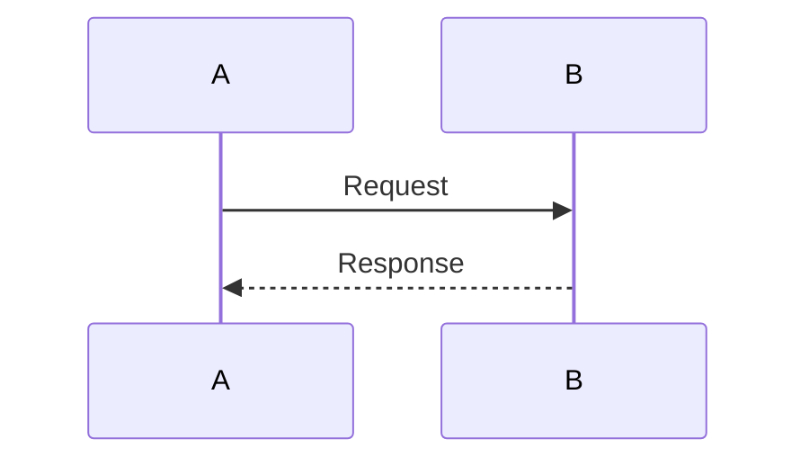
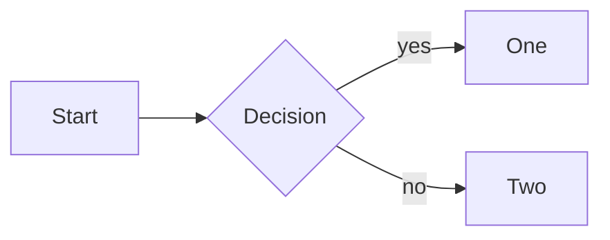
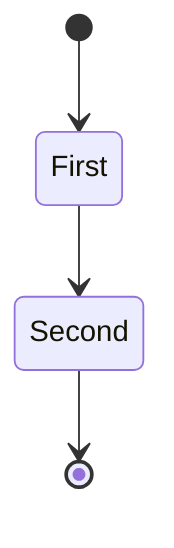
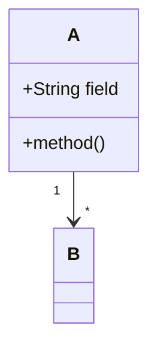
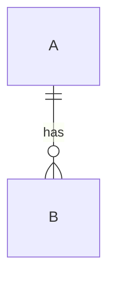
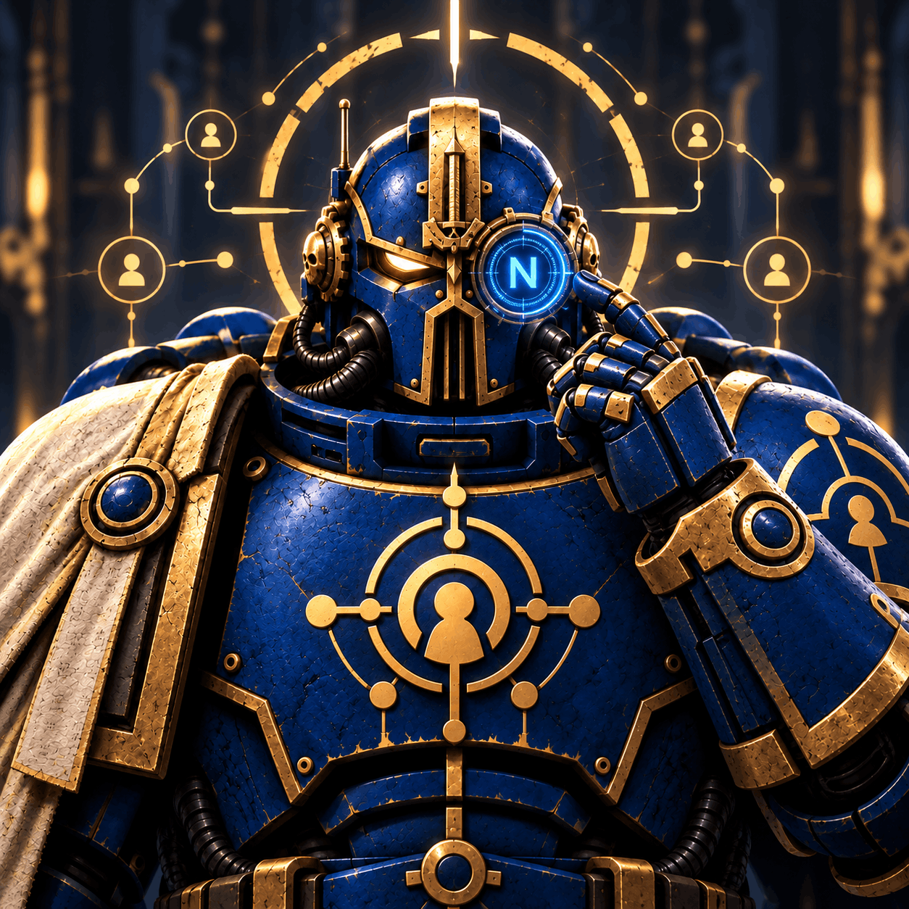

# Component test

A test page for the components Material for MkDocs supports. Placeholder content only.

## Text formatting

- **Bold**, *italic*, ***bold italic***
- ==Highlighted==, ^^inserted^^, ~~deleted~~
- H~2~O (subscript), x^2^ (superscript)
- `inline code`, and highlighted inline code: `#!go fmt.Println("hi")`
- Keyboard keys: ++ctrl+c++, ++cmd+shift+p++
- Smart symbols: (c) (tm) (r) --> <-- +/- != 1/2
- Link: [Material for MkDocs](https://squidfunk.github.io/mkdocs-material/)
- Abbreviation: hover over HTML or CSS.

*[HTML]: Hyper Text Markup Language
*[CSS]: Cascading Style Sheets

## Admonitions

!!! note
    Note admonition.

!!! abstract
    Abstract admonition.

!!! info
    Info admonition.

!!! tip
    Tip admonition.

!!! success
    Success admonition.

!!! question
    Question admonition.

!!! warning
    Warning admonition.

!!! failure
    Failure admonition.

!!! danger
    Danger admonition.

!!! bug
    Bug admonition.

!!! example
    Example admonition.

!!! quote
    Quote admonition.

!!! note "Custom title"
    Admonition with a custom title.

!!! note ""
    Admonition without a title.

??? info "Collapsible (closed)"
    Hidden until expanded.

???+ tip "Collapsible (open)"
    Expanded by default.

!!! info inline end "Inline end"
    Floats to the right of the text.

Text next to an inline admonition. Lorem ipsum dolor sit amet, consectetur adipiscing elit. Nulla et euismod nulla. Curabitur feugiat, tortor non consequat finibus, justo purus auctor massa, nec semper lorem quam in massa.

## Code blocks

```go title="main.go" linenums="1" hl_lines="6"
package main

import "fmt"

func main() {
	fmt.Println("hello") // (1)!
}
```

1.  A code annotation. Click the marker in the code block.

```bash
make docs
```

```yaml
key: value
list:
  - a
  - b
```

## Content tabs

=== "Go"

    ```go
    fmt.Println("hello")
    ```

=== "Python"

    ```python
    print("hello")
    ```

=== "Text"

    Tabs can hold any content.

## Diagrams











## Tables

| Left | Center | Right |
|:-----|:------:|------:|
| a    |   b    |     c |
| d    |   e    |     f |

## Lists

- Unordered
    - Nested

1. Ordered
2. Ordered

- [x] Done task
- [ ] Open task

Term
:   Definition of the term.

## Footnotes

Text with a footnote.[^1]

[^1]: The footnote.

## Math

Inline: \(a^2 + b^2 = c^2\)

$$
\sum_{i=1}^{n} i = \frac{n(n+1)}{2}
$$

## Icons and emoji

:material-account: :fontawesome-brands-github: :octicons-key-16: :smile: :lock:

## Buttons

[Primary button](#){ .md-button .md-button--primary }
[Button](#){ .md-button }

## Grid cards

<div class="grid cards" markdown>

-   :material-clock-fast: **Card one**

    ---

    Card content.

-   :material-scale-balance: **Card two**

    ---

    Card content.

</div>

## Images

{ width="120" }

## Critic markup

{++Added++} {--Removed--} {~~old~>new~~} {==Highlighted==} {>>Comment<<}

## Tooltips

[Hover me](#tooltips "Tooltip text")
